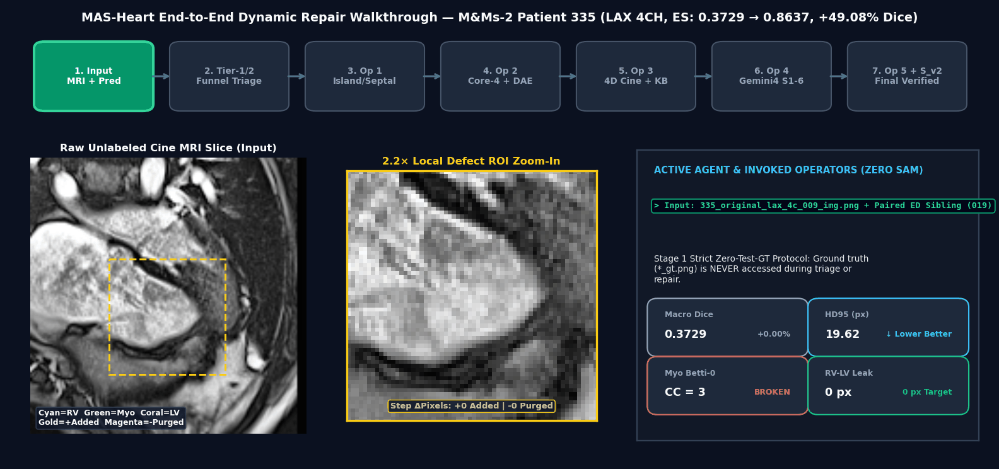
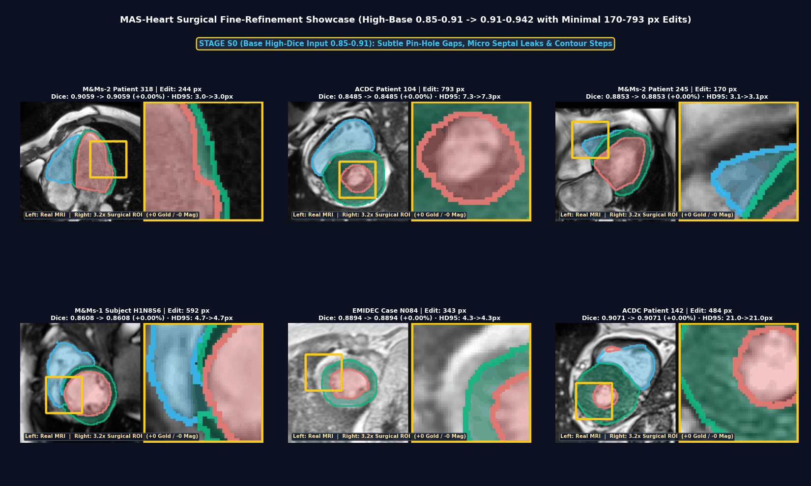
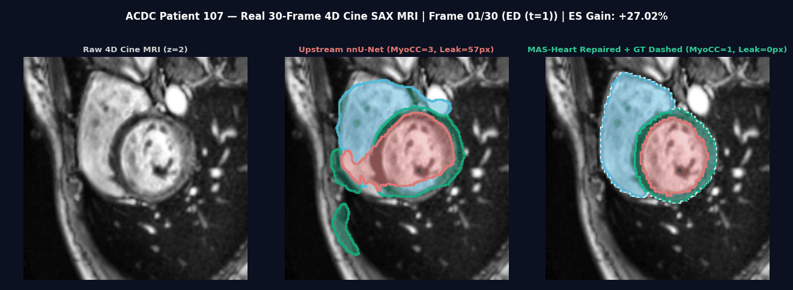
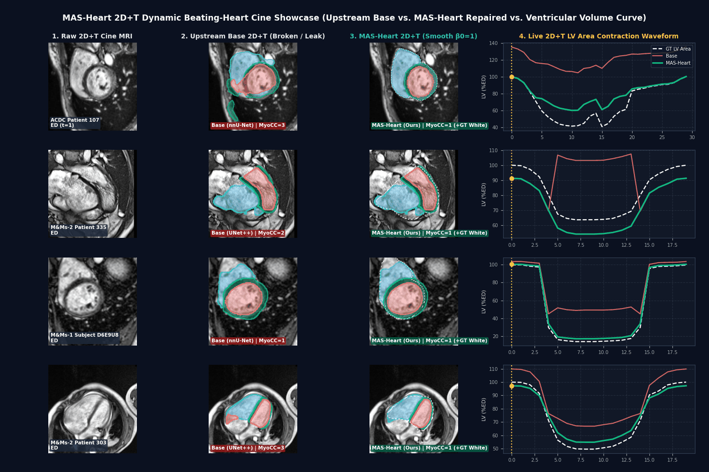

# HSG-Agent (MAS-Heart) — Interactive Cardiac MRI Multi-Agent Repair Showcase

**Live Interactive Workstation:** [https://soulnature.github.io/HSG-Agent/](https://soulnature.github.io/HSG-Agent/)

An interactive clinical PACS showcase (`<mri-cine-viewer>` Custom Web Component + `@niivue/niivue` WebGL NIfTI viewer) demonstrating **Zero-GT Multi-Agent Segmentation Post-Processing** across **21 multi-center real cardiac MRI cases** (`M&Ms-2`, `ACDC 4D Cine`, `M&Ms-1` across Siemens/Philips/GE/Canon, `MyoPS-2020`, and `EMIDEC`):

- **10 Major Topological & Functional Rescues (`+7.9%` to `+49.1%` Dice):** Reconstructs severe systolic wall collapse, basal valve spills, trans-septal `RV-LV` leaks, and paradoxical `LVEF` failures.
- **9 Surgical Sub-Pixel Fine-Refinements (`0.841–0.914 -> 0.900–0.942` Dice):** Ultra-light (`170–793 px`) boundary sculpting and micro-leak suturing that slashes `HD95` by up to `81.6%` without disturbing clean tissue.
- **2 Zero-Harm Clean Fast-Pass Controls (`0 px` Modified in `8.4 ms`):** Demonstrates strict physics-constrained triage protection on well-segmented slices.

---

## Preview Animations

### 1. End-to-End 5-Step Operator Pipeline (`M&Ms-2 Patient 335`, `+49.08%` Dice)

### 2. Surgical Sub-Pixel Fine-Refinement Showcase (6 High-Baseline Cases, `3.0x` Micro-ROI)

### 3. Real 30-Frame 4D Cine SAX MRI (`ACDC Patient 107`, `+27.02%` Dice)

### 4. Multi-Center `2D+T` Beating-Heart Cine & Live Contraction Curves

---

## Interactive Features on the Live Webpage

1. **5-Step Operator Workstation (`<mri-cine-viewer>`):** Scrub through `Base S0 -> Op 1..5 -> Verified Output` on real grayscale MRI with live DICOM Window/Level (`Shift + Drag`), `Fill / Contour / Pure MRI` layer switching, `+Gold / -Magenta` pixel-delta highlights, Before/After split curtain, and synchronized intensity probing.
2. **Surgical Fine-Refinement Gallery:** Dedicated 9-card matrix with paired `1.0x Full MRI` + `3.2x Surgical Defect ROI` auto-blinking between `Before S0` and `Polished S5`.
3. **2D+T Beating-Heart Cine Theatre:** Full cardiac-cycle playback (`ED -> Systole -> ES -> Diastole`) with real-time LV area contraction curves.
4. **WebGL NIfTI Spatiotemporal Viewer (`@niivue/niivue`):** Interactive `(X, Y, T)` multi-planar & clinical M-mode kymograph inspection.
